# Database - ERD (Phase 1 + Phase 2 + Phase 2b + Phase 3 + Phase 4 + Phase 5 + Phase 6 + Phase 7 + Phase 12 + Phase 13 + Phase 14 + Phase 15)

```mermaid
erDiagram
    ORGANIZATION ||--o{ FARM : owns
    ORGANIZATION ||--o{ USER : employs
    ORGANIZATION ||--o{ ROLE : defines
    ORGANIZATION ||--o{ AUDIT_LOG : scopes
    ORGANIZATION ||--o{ ANIMAL : owns
    ORGANIZATION ||--o{ INVENTORY_ITEM : owns
    ORGANIZATION ||--o{ CUSTOMER : has
    USER ||--o{ NOTIFICATION : receives
    USER ||--o{ NOTIFICATION_PREFERENCE : sets

    ROLE ||--o{ ROLE_PERMISSION : grants
    PERMISSION ||--o{ ROLE_PERMISSION : "granted via"
    USER ||--o{ USER_ROLE : has
    ROLE ||--o{ USER_ROLE : "assigned as"

    USER ||--o{ REFRESH_TOKEN : issues

    FARM ||--o{ BRANCH : has
    BRANCH ||--o{ LOCATION : contains
    FARM ||--o{ ANIMAL : contains
    LOCATION ||--o{ ANIMAL : "currently houses"

    ANIMAL ||--o{ ANIMAL_EVENT : "timeline of"
    ANIMAL ||--o{ WEIGHT_RECORD : "weight history of"
    ANIMAL ||--o{ MOVEMENT : "location history of"
    ANIMAL ||--o{ HEALTH_RECORD : "vet history of"
    ANIMAL ||--o{ BREEDING_RECORD : "bred as dam"
    ANIMAL ||--o{ LACTATION_CYCLE : "lactation history of"
    ANIMAL ||--o{ MILK_PRODUCTION_RECORD : "milk history of"
    LOCATION ||--o{ MOVEMENT : "from/to"
    BREEDING_RECORD ||--o{ PREGNANCY_CHECK : "checks for"
    LACTATION_CYCLE ||--o{ MILK_PRODUCTION_RECORD : "sessions in"
    INVENTORY_ITEM ||--o{ STOCK_MOVEMENT : "ledger of"
    ANIMAL ||--o| LISTING : "listed as"
    ANIMAL ||--o{ RESERVATION : "reserved as"
    ANIMAL ||--o{ ORDER_ITEM : "ordered as"
    CUSTOMER ||--o{ RESERVATION : holds
    CUSTOMER ||--o{ ORDER : places
    ORDER ||--o{ ORDER_ITEM : contains
    ORDER ||--o{ ORDER_STATUS_EVENT : "status history of"
    ORDER ||--o{ PAYMENT : "paid via"
    ORDER ||--o| INVOICE : "invoiced as"
    PAYMENT ||--o{ PAYMENT_WEBHOOK_EVENT : "confirmed by"
    ORGANIZATION ||--o| FARM_PROFILE : "public profile is"
    ORGANIZATION ||--o{ TESTIMONIAL : has
    ORGANIZATION ||--o{ BLOG_POST : publishes
    ORGANIZATION ||--o{ FAQ : answers
    ORGANIZATION ||--o{ BANNER : displays
    ORGANIZATION ||--o{ SUPPLIER : "buys from"
    ORGANIZATION ||--o{ PURCHASE_ORDER : places
    ORGANIZATION ||--o{ EMPLOYEE : employs
    ORGANIZATION ||--o{ ASSET : owns

    SUPPLIER ||--o{ PURCHASE_ORDER : fulfills
    PURCHASE_ORDER ||--o{ PURCHASE_ORDER_ITEM : contains
    PURCHASE_ORDER ||--o{ PURCHASE_ORDER_STATUS_EVENT : "status history of"
    PURCHASE_ORDER_ITEM }o--o| INVENTORY_ITEM : "receives into (if linked)"
    SUPPLIER ||--o{ ASSET : "sold (optional)"

    EMPLOYEE ||--o{ EMPLOYEE_STATUS_EVENT : "status history of"
    EMPLOYEE ||--o{ WORK_SHIFT : scheduled
    EMPLOYEE }o--o| USER : "may be login for"
    FARM ||--o{ EMPLOYEE : "assigned to"
    LOCATION ||--o{ EMPLOYEE : "assigned to"

    ASSET ||--o{ ASSET_MAINTENANCE_RECORD : "maintenance history of"
    FARM ||--o{ ASSET : "assigned to"

    USER }o--o| CUSTOMER : "may be login for (Phase 15)"

    ORGANIZATION {
        uuid id PK
        string name
        string slug
        string currency
        string timezone
        timestamptz created_at
    }
    USER {
        uuid id PK
        uuid organization_id FK
        string email
        string phone
        string password_hash
        string full_name
        bool is_active
        bool mfa_enabled
        uuid customer_id FK "nullable, Phase 15 customer-portal link"
        timestamptz created_at
    }
    ROLE {
        uuid id PK
        uuid organization_id FK
        string name
        string description
        bool is_system
    }
    PERMISSION {
        uuid id PK
        string code UK
        string description
    }
    ROLE_PERMISSION {
        uuid role_id FK
        uuid permission_id FK
    }
    USER_ROLE {
        uuid user_id FK
        uuid role_id FK
    }
    REFRESH_TOKEN {
        uuid id PK
        uuid user_id FK
        string token_hash
        timestamptz expires_at
        bool revoked
    }
    FARM {
        uuid id PK
        uuid organization_id FK
        string name
        string county
        string address
    }
    BRANCH {
        uuid id PK
        uuid farm_id FK
        string name
    }
    LOCATION {
        uuid id PK
        uuid branch_id FK
        string name
        string location_type
    }
    AUDIT_LOG {
        uuid id PK
        uuid organization_id FK
        uuid user_id FK
        string action
        string entity_type
        uuid entity_id
        jsonb previous_value
        jsonb new_value
        string ip_address
        timestamptz created_at
    }
    ANIMAL {
        uuid id PK
        uuid organization_id FK
        uuid farm_id FK
        uuid location_id FK
        uuid dam_id FK
        uuid sire_id FK
        string animal_number UK "unique per org"
        string ear_tag
        string rfid
        string species
        string breed
        string category
        string sex
        date date_of_birth
        date acquisition_date
        string acquisition_method
        numeric acquisition_cost
        numeric current_value
        numeric expected_sale_price
        numeric current_weight
        string status
        string health_status
        string reproductive_status
        timestamptz created_at
    }
    ANIMAL_EVENT {
        uuid id PK
        uuid animal_id FK
        string event_type
        timestamptz event_at
        jsonb data
        uuid recorded_by
        timestamptz created_at
    }
    WEIGHT_RECORD {
        uuid id PK
        uuid animal_id FK
        numeric weight_kg
        timestamptz recorded_at
        uuid recorded_by
    }
    MOVEMENT {
        uuid id PK
        uuid animal_id FK
        uuid from_location_id FK
        uuid to_location_id FK
        timestamptz moved_at
        string reason
        uuid authorized_by
    }
    HEALTH_RECORD {
        uuid id PK
        uuid organization_id FK
        uuid animal_id FK
        string record_type
        string title
        string diagnosis
        string medication
        numeric cost
        timestamptz performed_at
        date follow_up_date
        bool follow_up_completed
        uuid recorded_by
    }
    BREEDING_RECORD {
        uuid id PK
        uuid organization_id FK
        uuid dam_id FK
        uuid sire_id FK
        string sire_external
        string method
        date mating_date
        date expected_delivery_date
        string pregnancy_status
        date actual_delivery_date
        int offspring_count
    }
    PREGNANCY_CHECK {
        uuid id PK
        uuid breeding_record_id FK
        date check_date
        string result
        uuid performed_by
    }
    LACTATION_CYCLE {
        uuid id PK
        uuid organization_id FK
        uuid animal_id FK
        date start_date
        date end_date
        bool is_active
    }
    MILK_PRODUCTION_RECORD {
        uuid id PK
        uuid organization_id FK
        uuid animal_id FK
        uuid lactation_cycle_id FK
        date production_date
        string session
        numeric quantity_liters
        bool rejected
    }
    INVENTORY_ITEM {
        uuid id PK
        uuid organization_id FK
        uuid farm_id FK
        string name
        string category
        string unit
        numeric reorder_level
        bool allow_negative_stock
    }
    STOCK_MOVEMENT {
        uuid id PK
        uuid organization_id FK
        uuid item_id FK
        string movement_type
        numeric quantity "signed: +in / -out"
        numeric unit_cost
        string batch_number
        date expiry_date
        uuid animal_id "optional, for feed-cost-per-animal"
        timestamptz moved_at
    }
    CUSTOMER {
        uuid id PK
        uuid organization_id FK
        string name
        string phone
        string email
        string customer_type
    }
    LISTING {
        uuid id PK
        uuid organization_id FK
        uuid animal_id FK "one ACTIVE listing per animal, partial unique index"
        string slug "SEO-friendly public URL, Phase 7"
        string title
        string pricing_type
        numeric price
        bool featured
        bool is_active
    }
    RESERVATION {
        uuid id PK
        uuid organization_id FK
        uuid animal_id FK "one ACTIVE reservation per animal, partial unique index"
        uuid customer_id FK
        date reservation_date
        date expiry_date
        numeric deposit_amount
        string status
    }
    ORDER {
        uuid id PK
        uuid organization_id FK
        uuid customer_id FK
        string status
        string delivery_option
        numeric total_amount
    }
    ORDER_ITEM {
        uuid id PK
        uuid order_id FK
        uuid animal_id FK
        numeric price "snapshot at time of order"
    }
    ORDER_STATUS_EVENT {
        uuid id PK
        uuid order_id FK
        string from_status
        string to_status
        uuid changed_by
        timestamptz changed_at
    }
    PAYMENT {
        uuid id PK
        uuid organization_id FK
        uuid order_id FK
        string provider "mock|mpesa|stripe"
        string provider_reference
        numeric amount
        string currency
        string status "advanced only by verified webhook"
        timestamptz initiated_at
        timestamptz completed_at
    }
    PAYMENT_WEBHOOK_EVENT {
        uuid id PK
        uuid payment_id FK
        string provider
        string event_id "UNIQUE with provider - idempotency key"
        string status
        jsonb raw_payload
        timestamptz received_at
    }
    FINANCE_TRANSACTION {
        uuid id PK
        uuid organization_id FK
        string transaction_type "income|expense"
        string category
        numeric amount
        string reference_type "order|animal|payment|manual"
        uuid reference_id
        date transaction_date
        timestamptz created_at
    }
    INVOICE {
        uuid id PK
        uuid organization_id FK
        uuid order_id FK "UNIQUE - one invoice per order"
        uuid customer_id FK
        string invoice_number "UNIQUE per org, sequential"
        numeric subtotal
        numeric tax_amount
        numeric total
        timestamptz issued_at
    }
    INVOICE_COUNTER {
        uuid organization_id PK
        int next_number
    }
    NOTIFICATION {
        uuid id PK
        uuid organization_id FK
        uuid user_id FK
        string category
        string title
        string body
        string related_entity_type
        uuid related_entity_id
        bool is_read
        timestamptz created_at
    }
    NOTIFICATION_PREFERENCE {
        uuid user_id PK
        string category PK
        bool enabled
    }
    FARM_PROFILE {
        uuid id PK
        uuid organization_id FK "UNIQUE - one profile per org"
        string farm_name
        string tagline
        text farm_story
        string logo_url
        string county
        int established_year
    }
    TESTIMONIAL {
        uuid id PK
        uuid organization_id FK
        string customer_name
        text quote
        int rating "1-5"
        bool is_published
        bool is_featured
    }
    BLOG_POST {
        uuid id PK
        uuid organization_id FK
        string slug "UNIQUE per org"
        string title
        text body
        bool is_published
        timestamptz published_at
    }
    FAQ {
        uuid id PK
        uuid organization_id FK
        string question
        text answer
        int sort_order
        bool is_published
    }
    BANNER {
        uuid id PK
        uuid organization_id FK
        string title
        string image_url
        bool is_active
        date starts_at
        date ends_at
    }
    SUPPLIER {
        uuid id PK
        uuid organization_id FK
        string name
        string contact_person
        string phone
        string email
        string tax_pin
        bool is_active
    }
    PURCHASE_ORDER {
        uuid id PK
        uuid organization_id FK
        uuid supplier_id FK
        string po_number
        string status
        date order_date
        date expected_delivery_date
        uuid requested_by
        uuid approved_by
    }
    PURCHASE_ORDER_ITEM {
        uuid id PK
        uuid purchase_order_id FK
        uuid inventory_item_id FK "nullable"
        string description
        numeric quantity
        numeric unit_cost
    }
    PURCHASE_ORDER_STATUS_EVENT {
        uuid id PK
        uuid purchase_order_id FK
        string from_status
        string to_status
        uuid changed_by
        timestamptz changed_at
    }
    EMPLOYEE {
        uuid id PK
        uuid organization_id FK
        uuid user_id FK "nullable"
        string employee_number
        string full_name
        string department
        string job_title
        string employment_type
        string employment_status
        uuid assigned_farm_id FK
        uuid assigned_location_id FK
        date hire_date
        date termination_date
    }
    EMPLOYEE_STATUS_EVENT {
        uuid id PK
        uuid employee_id FK
        string from_status
        string to_status
        uuid changed_by
        timestamptz changed_at
    }
    WORK_SHIFT {
        uuid id PK
        uuid employee_id FK
        date shift_date
        time start_time
        time end_time
        uuid location_id FK
    }
    ASSET {
        uuid id PK
        uuid organization_id FK
        string asset_number
        string name
        string asset_type
        string status
        string condition
        date acquisition_date
        numeric acquisition_cost
        int useful_life_years
        numeric salvage_value
        uuid assigned_farm_id FK
        uuid supplier_id FK "nullable, Phase 12 link"
    }
    ASSET_MAINTENANCE_RECORD {
        uuid id PK
        uuid asset_id FK
        string maintenance_type
        date maintenance_date
        string description
        numeric cost
        date next_due_date
    }
```

## Notes
- All PKs are UUIDs (spec §30 - no exposed sequential IDs).
- `AUDIT_LOG`, `ANIMAL_EVENT`, `WEIGHT_RECORD`, and `MOVEMENT` are all append-only:
  no UPDATE/DELETE routes exist, and a shared DB trigger
  (`reject_audit_log_mutation`, added in migration `0002`, reused by `0003`)
  rejects UPDATE/DELETE at the Postgres level on all four tables.
- `HEALTH_RECORD` (migration `0004`) is *not* covered by that trigger - it needs
  exactly one mutable field, `follow_up_completed`, so a legitimate "mark done"
  action isn't blocked. The service layer only ever touches that column; this
  trade-off is called out explicitly rather than silently deviating from the
  append-only pattern used everywhere else.
- `PREGNANCY_CHECK`, `MILK_PRODUCTION_RECORD`, and `STOCK_MOVEMENT` (migration
  `0005`) all reuse the same append-only trigger as `ANIMAL_EVENT`/`MOVEMENT` -
  corrections are new rows (an `adjustment` movement, a follow-up
  `pregnancy_check`), never edits to history.
- `STOCK_MOVEMENT.quantity` is always signed by the service layer before
  insert (positive for purchase/opening_balance/return, negative for
  consumption/wastage/expired/sale/transfer); `adjustment` is the one type
  where the caller supplies the signed delta directly. Current stock is never
  a stored counter - it's `SUM(quantity)` computed at read time, so the ledger
  itself is always the source of truth (spec §14, §52.11).
- `MILK_PRODUCTION_RECORD` has a DB-level unique constraint on
  `(animal_id, production_date, session)` - the same cow can't have two
  "morning" entries on the same day.
- `LISTING` and `RESERVATION` each have a **partial unique index** (`WHERE
  is_active = true` / `WHERE status = 'active'`), not a plain unique
  constraint - an animal can accumulate many *inactive* listings/reservations
  over its history, just never more than one *active* one at a time. This is
  the DB-level backstop behind the row-locking in `commerce/service.py` that
  prevents two customers reserving or ordering the same animal concurrently.
- **Testing infrastructure note:** the test suite (`tests/conftest.py`) runs
  real Alembic migrations against a disposable database per test, not
  `Base.metadata.create_all()`. This was a deliberate fix mid-Phase-4 after
  `create_all()` was found to silently skip every constraint expressed as raw
  SQL in a migration rather than as a SQLAlchemy Column/Constraint object -
  including the partial unique indexes above and all the append-only triggers.
  A test suite built on `create_all()` would have kept passing even if those
  DB-level guarantees were silently broken.
- `PAYMENT_WEBHOOK_EVENT` has a DB unique constraint on `(provider, event_id)`
  - this, not an application-level check, is the actual idempotency guarantee
  behind "never process the same payment callback twice" (spec §20). It also
  reuses the append-only trigger, same as every other historical-fact table.
- `FINANCE_TRANSACTION` is append-only for the same reason as the inventory
  ledger (§14/§23) - a correction is a new (reversing) transaction, never an
  edit to a past one.
- `INVOICE.order_id` has its own unique constraint (one invoice per order),
  separate from `INVOICE.invoice_number`'s per-org uniqueness - the two are
  enforced independently. `INVOICE_COUNTER` hands out sequential numbers under
  a row lock (`SELECT ... FOR UPDATE`), the same locking pattern used for
  animal availability in Phase 4's commerce module.
- `animal_number` is unique per organization (`uq_animals_org_animal_number`),
  not globally - spec §60 makes numbering format an org-level setting.
- `NOTIFICATION` is intentionally **not** append-only - `is_read` needs to
  flip, same trade-off as `HEALTH_RECORD.follow_up_completed` in Phase 2b.
  `NOTIFICATION_PREFERENCE` has no row for "default enabled"; absence of a
  `(user_id, category)` row means enabled, so most users never need a row at
  all - only opt-outs are stored.
- `Permission` is global (not per-org) - the catalog of what's checkable. `RolePermission`
  is what's actually granted, per-org via `Role`.
- `FARM_PROFILE` is intentionally a **separate table from `ORGANIZATION`**,
  not additional columns on it - `Organization` holds internal tenant config
  (currency, timezone, the `slug` used for both auth routing and public URL
  resolution); `FarmProfile` holds what a public-site visitor actually sees.
  A marketing copy edit can never accidentally touch billing/tenant settings,
  and vice versa.
- `BLOG_POST.slug` is unique per organization (`uq_blog_posts_org_slug`), same
  pattern as `animal_number` - not globally unique, since multiple tenants
  will naturally reuse common slugs ("about-us", "our-story").
- `LISTING.slug` has no uniqueness constraint at the DB level (unlike
  `BLOG_POST.slug`) - it's generated with a random suffix
  (`commerce/service.py::_generate_listing_slug`) specifically to make
  collisions practically impossible without needing to enforce or check
  uniqueness, since a listing's title/breed/animal-number inputs aren't
  guaranteed unique the way a blog post's human-chosen title is.
- **Phases 12-15 (this session), added after the diagram above was first
  drawn:** `PURCHASE_ORDER_STATUS_EVENT` and `EMPLOYEE_STATUS_EVENT` reuse
  the exact same append-only trigger (`reject_audit_log_mutation`, migration
  `0002`) as `AUDIT_LOG`/`ANIMAL_EVENT`/`MOVEMENT`/`ORDER_STATUS_EVENT` - the
  trigger has now been attached to five different tables across five phases
  without being redefined once. `ASSET_MAINTENANCE_RECORD` is deliberately
  an ordinary (non-append-only) table with no corresponding trigger - unlike
  a status transition, a maintenance log entry is never corrected by a
  reversing row; it just accumulates, so the append-only *trigger*
  specifically wasn't needed even though the "keep history, don't overwrite"
  *principle* still applies (nothing ever updates or replaces an existing
  record instead of inserting a new one).
- `ASSET.current_value`/`total_maintenance_cost` and `PURCHASE_ORDER
  .total_amount` are **not columns** - they're computed at read time by the
  service layer (straight-line depreciation from `acquisition_cost`/
  `useful_life_years`/`salvage_value`; a `SUM()` over line items,
  respectively) and only appear in the API response schema, the same
  "derived, not stored" treatment `INVENTORY_ITEM`'s current-stock total
  already gets above.
- `USER.customer_id` and `EMPLOYEE.user_id` are both nullable, both
  deliberately **not** unique-constrained at the DB level - a `User` isn't
  forced to have exactly one `Employee`/`Customer` record, since neither
  relationship needed that guarantee for anything built so far and adding
  an unnecessary constraint would make a legitimate future edge case
  (e.g. re-linking) harder than it needs to be, not easier.
- `PURCHASE_ORDER_ITEM.inventory_item_id` is nullable on purpose: a PO line
  for something not tracked in the inventory ledger (e.g. a one-off service
  charge) is received without creating a `STOCK_MOVEMENT`, while a line that
  *is* linked creates a real one tagged with the PO number as its
  `reference` - see `docs/architecture.md`'s Phase 12 entry for the full
  reasoning and the regression test that checks both branches.
